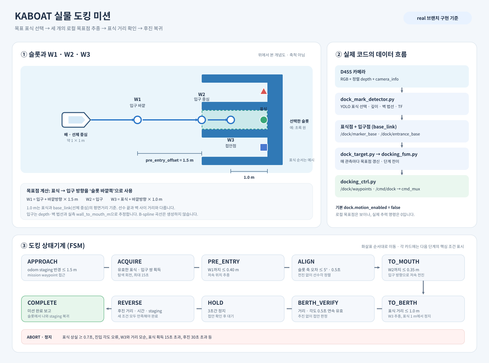

# D455 + YOLO26 도킹 입구 ROS 통합



현재 가중치는 `YOLO_KABOAT/results/run_yolo26_1/dock_sequence_v3_yolo26n_best.pt`이다.
합성 test 보강 후 기존 모델의 box/mask mAP50–95는 각각 0.953/0.835였다.
이 수치는 실해상·D455 depth·Jetson 지연을 검증하지 않는다.

## 데이터 흐름

1. `d455.launch.py`가 RGB, **RGB에 정렬된 depth**, color camera_info를 발행한다.
2. `dock_mark_detector`는 `/detector/enable=true`일 때만 YOLO26n-seg를 돌린다.
   세 클래스는 `red_triangle`, `green_circle`, `blue_square`이며 각 클래스의
   최고 신뢰도 마스크 하나만 사용한다.
3. 마스크 안의 유효 depth 중앙값으로 광학계 3D 마커 좌표를 구하고, 표식
   평면의 법선을 추정한다. depth·법선 품질이 부족하면 입구를 발행하지 않는다.
4. 카메라 광학 프레임에서 `base_link`로 측정 시각의 TF를 적용한다. 마커의
   3D 좌표는 `/dock/marker_base`, 법선 방향으로 `wall_to_mouth_m` 이동한
   **z=0 선체 기준 입구 XY**는 `/dock/entrance_base`로 발행한다.
5. `docking_ctrl`은 표식과 입구 사이의 방향으로 세 목표점을 만든다.
   `W1=입구 바깥 1.5m`, `W2=입구 중심`, `W3=표식 앞 1.0m`이다.
   곡선 경로를 생성하지 않고 W1→W2→W3 순으로 직선 목표점 추종을 한다.
   W1에서 슬롯 축과 선수각을 맞추고, W2에 도착해야 W3로 넘어간다.
   표식까지 **1.0m 이내**에서 추진을 멈춘 뒤 `BERTH_VERIFY`로 0.5초
   연속 확인한다. 3초간 `HOLD` 후 후진한다. 세 목표점은
   `/dock/waypoints`(`nav_msgs/Path`, `base_link`)로 발행한다.
   `/detections/dock_marks`는 호환/관측용이며 제어 입력으로 쓰지 않는다.

도킹 상태는 `APPROACH → ACQUIRE → PRE_ENTRY → ALIGN → TO_MOUTH → TO_BERTH
→ BERTH_VERIFY → HOLD → REVERSE → COMPLETE`다. `BERTH_VERIFY` 이후
`HOLD` 진입이 접안 확인이고, `COMPLETE`는 후진해 staging 지점으로
복귀한 뒤의 미션 완료다. 근접 구간에서 표식을 잃거나 슬롯 축과의 각도가
허용값을 넘으면 `ABORT`로 정지한다. 후진 완료는
최소 시간, 실제 odom 이동거리, staging 반경을 모두 만족해야 한다.
`ACQUIRE`가 15초 넘게 표식을 찾지 못해도 `ABORT`로 정지한다.

## 첫 배선 점검: 모터 비활성

ROS 2 Humble 환경에서 `kaboat_msgs`, `kaboat_perception`, `kaboat_behaviors`,
`kaboat_bringup`을 빌드한다. detector를 실행하는 **동일 Python 환경**에서
`cv2`, `cv_bridge`, `message_filters`, `tf2_geometry_msgs`, `ultralytics`,
해당 Jetson용 PyTorch 빌드가 import되는지 확인한다. 가중치 파일을 Jetson의
접근 가능한 절대 경로에 배치한다.

개발 PC의 사용자 설치 NumPy 2.2.6은 ROS Humble `cv_bridge`(NumPy 1.x로
빌드됨)와 호환되지 않았다. detector는 NumPy 2 환경에서 명시적으로 중단한다.
Jetson에서도 **ROS와 YOLO가 같은 Python에서 NumPy 1.x, OpenCV, PyTorch를
함께 불러올 수 있는지** 먼저 확인해야 한다. 이 PC에서는 Ultralytics와
ROS-compatible NumPy가 한 환경에 준비되지 않아 ROS 실시간 추론까지는
검증하지 못했다. 기존 `.pt` 모델의 일반 Python 추론과 ROS 패키지 빌드는
각각 확인했다.

카메라 드라이버를 켠 뒤 이미지 `header.frame_id`를 확인하고,
`base_link`까지 **실측 장착 위치/자세의 TF**가 있는지 확인한다. RealSense
자체 TF만으로는 선체 장착 TF가 생기지 않는다. 임의의 0 변환을 넣으면
입구 좌표가 틀리므로 사용하지 않는다. 실제 마커 벽에서 도킹 입구까지의
수평 거리도 측정해 `wall_to_mouth_m`에 넣는다.

```bash
ros2 launch kaboat_bringup d455.launch.py
ros2 topic echo --once /camera/color/image_raw --field header
ros2 run tf2_ros tf2_echo base_link camera_color_optical_frame
ros2 topic echo /dock/detection_status
ros2 topic echo /dock/marker_base
ros2 topic echo /dock/entrance_base
```

위 `camera_color_optical_frame`은 예시다. 실제 이미지 header의 frame_id로
바꾸고, `wall_to_mouth_m:=2.5`도 **현장 실측값으로 바꿔야 한다**. 기본값
2.5m는 가정치이므로 이대로 추력을 켜면 안 된다.

현재 계획은 표식이 각 슬롯의 뒷벽 중앙에 있고, 선체가 약 1×1m이며 D455와
라이다를 선체 중앙에 장착하는 것이다. `dock.berth_distance=1.0`은
`base_link`(선체 중심)에서 표식까지의 수평거리다. 선수 끝과 벽의 여유는
센서 장착 좌표 및 실제 선체 치수로 따로 확인해야 한다.

주의: `autonomy.launch.py`는 다른 mission behavior도 포함한다. 모터가 연결된
선체에서 첫 점검을 할 때는 카메라와 detector만 띄우고,
`/detector/enable`을 활성화해 좌표를 관찰한다. 상태 `valid=false`면
입구 좌표가 갱신되지 않으며 제어기에는 수신 신선도 0.35초와 이미지 시각
최대 지연 0.5초 제한이 있다. 별도 detector 실행 예:

```bash
ros2 run kaboat_perception dock_mark_detector --ros-args \
  -p weights:=/absolute/path/dock_sequence_v3_yolo26n_best.pt \
  -p target_class:=red_triangle -p device:=cpu -p wall_to_mouth_m:=2.5
ros2 topic pub --rate 1 --qos-durability transient_local \
  /detector/enable std_msgs/msg/Bool '{data: true}'
```

센서 좌표가 확인된 다음에는 단일 도킹 미션 런처를 사용한다. 실행 전에
`indoor_tank.launch.py`(실내) 또는 실외 위치추정으로 `/odom`, D455로
RGB·정렬된 depth·camera_info, 정확한 `base_link→카메라` TF를 준비한다.
아래 런처는 다른 미션과 모터 드라이버를 실행하지 않으며 기본 추력은 0이다.

```bash
ros2 launch kaboat_bringup real_docking_test.launch.py \
  staging_x:=<실측_odom_X> staging_y:=<실측_odom_Y> \
  dock_weights:=/absolute/path/dock_sequence_v3_yolo26n_best.pt \
  dock_target_class:=red_triangle wall_to_mouth_m:=<실측_m> \
  pre_entry_offset_m:=1.5 hull_length_m:=<실측_m> \
  dock_device:=cpu dock_motion_enabled:=false
```

이 런처가 실행 중일 때 다른 터미널에서 `ros2 topic echo /dock/waypoints`
또는 RViz의 Path 표시로 W1·W2·W3 위치를 확인한다.

이 런처는 후진 최소거리를 `wall_to_mouth_m + hull_length_m/2 + 0.2m
- 1.0m`로 계산한다. 이는 접안 시 선체 중심이 벽에서 1m 떨어져 있다는
가정에 따른 거리이며, staging 지점이 W1보다 슬롯 바깥에 있고 후진
최소거리를 만족할 만큼 뒤에 있는지 확인해야 한다.

## 추력 활성화 전 확인

- 선체 정지 상태에서 세 표식의 클래스와 마스크, depth 중앙값, TF 방향을 확인.
- 목표 표식을 바꾸면 `dock_target_class`를 `green_circle` 또는
  `blue_square`로 지정하고 detector를 재시작.
- 거리별(약 2.5–8m) 입구 XY 오차, 법선 방향, `wall_to_mouth_m`을 실측 확인.
- `/dock/waypoints`의 W1·W2·W3가 실제 슬롯 중앙선에 차례대로 놓이는지 확인.
- W3에 도달했지만 표식 거리가 1m보다 크면 기하 불일치로 ABORT하는지 확인.
- 근접 구간에서 표식·입구 좌표가 끊기면 정지 후 ABORT하는지 확인.
- 비상정지, 주변 구조물과의 간격, 저속 추력·후진 동작을 별도 시험.
- 그 후에만 단일 도킹 런처의 `dock_motion_enabled:=true`를 검토한다.
  기본값은 **false**다.

도킹 FSM의 `APPROACH`는 mission waypoint까지의 `seek_goal`을 그대로
사용한다. 이후 W1·W2·W3는 현재 `base_link`에서 매 검출마다 갱신하는
로컬 목표다. 현재 코드는 양쪽 슬롯 벽의 간격이나 선체 폭을 검사하지 않는다.
전체 항로의 장애물 회피 planner도 도킹 입구까지 연결되지 않았으므로,
staging waypoint와 진입 경로의 안전성은 실물 시험 전에 별도로 검증해야 한다.
