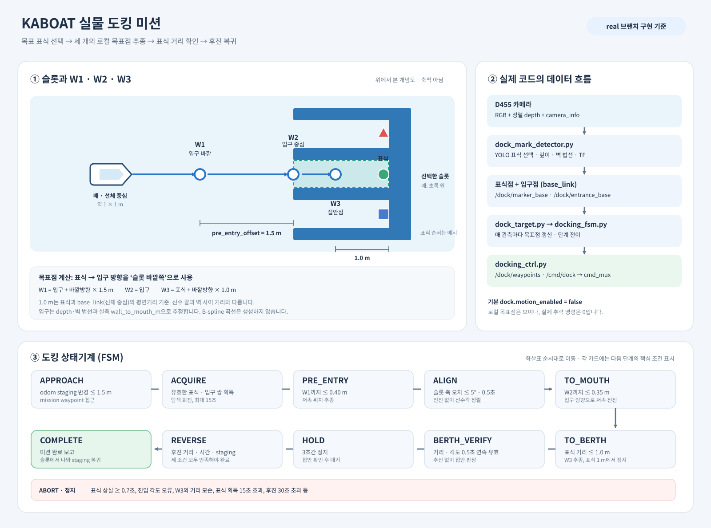

# D455 + YOLO26 도킹 입구 ROS 통합



현재 가중치는 `YOLO_KABOAT/results/run_yolo26_1/dock_sequence_v3_yolo26n_best.pt`이다.
합성 test 보강 후 기존 모델의 box/mask mAP50–95는 각각 0.953/0.835였다.
이 수치는 실해상·D455 depth·Jetson 지연을 검증하지 않는다.

## 데이터 흐름

1. `d455.launch.py`가 RGB, **RGB에 정렬된 depth**, color camera_info를 발행한다.
2. `dock_mark_detector`는 `/detector/enable=true`일 때만 YOLO26n-seg를 돌린다.
   세 클래스는 `red_triangle`, `green_circle`, `blue_square`이며 각 클래스의
   최고 신뢰도 마스크 하나만 사용한다.
3. 마스크 안의 유효 depth 중앙값으로 광학계 3D 마커 좌표를 구한다. **표식
   평면의 법선은 추정하지 않는다**(작은 평면이라 잡음이 크다). 유효 depth가
   부족하면 마커를 발행하지 않는다.
4. 카메라 광학 프레임에서 `base_link`로 측정 시각의 TF를 적용해 마커의 3D
   좌표를 `/dock/marker_base`로 발행한다. 이 값은 어느 슬롯인지와 표식의 대략
   위치만 알려준다.
5. `docking_ctrl`은 이 표식 위치 주변의 `/scan`에서 **뒷벽 직선을 맞춰**
   슬롯 축과 입구를 정한다(아래 절). 입구는 `/dock/entrance_base`로 모니터링용
   발행만 하고 제어 입력으로 다시 받지 않는다.
6. `docking_ctrl`은 표식과 입구 사이의 방향으로 세 목표점을 만든다.
   `W1=입구 바깥 1.5m`, `W2=입구 중심`, `W3=표식 앞 1.0m`이다.
   곡선 경로를 생성하지 않고 W1→W2→W3 순으로 직선 목표점 추종을 한다.
   W1에서 슬롯 축과 선수각을 맞추고, W2에 도착해야 W3로 넘어간다.
   표식까지 **1.0m 이내**에서 추진을 멈춘 뒤 `BERTH_VERIFY`로 0.5초
   연속 확인한다. 3초간 `HOLD` 후 후진한다. 세 목표점은
   `/dock/waypoints`(`nav_msgs/Path`, `base_link`)로 발행한다.
   `/detections/dock_marks`는 호환/관측용이며 제어 입력으로 쓰지 않는다.

### 슬롯 축과 입구는 라이다 뒷벽 직선으로만 정한다

depth 법선은 쓰지 않는다. YOLO+depth가 준 표식 위치(`/dock/marker_base`)를
중심으로 반경 1.3m 안의 `/scan` 점들에 RANSAC + 주성분 직선을 맞춘다
(`slot_axis.py`). 슬롯 3개가 벽을 공유하며 나란히 있어 뒷벽은 이웃까지 이어진
직선이지만, 창 반경이 슬롯 반폭(1.5m)보다 작아 모서리의 칸막이 벽 점은
들어오지 않는다.

- **슬롯 축** = 이 직선의 법선(선체 쪽 방향)이다. `axis_error`와 W1~W3가 여기서 나온다.
- **입구** = 표식을 직선에 투영한 점에서 법선 방향으로 `wall_to_mouth_m`
  떨어진 점이다. depth 거리 오차가 직선 투영으로 제거된다.
- **채택 조건:** 점 20개 이상, 길이 1.2m 이상, 잔차 3cm 이하, 창 안 점의 50%
  이상이 인라이어, 직선이 표식에서 35cm 이내, 벽 법선이 선체 시선과 75° 이내.
- **대체 추정이 없다.** 직선이 안 잡히거나 `/scan`이 0.5초 넘게 끊기면(또는
  마커가 없으면) 계획을 만들지 않는다. `ACQUIRE`에서는 탐색을 계속하고,
  진입 중에는 0.7초 뒤 `ABORT`한다.
- `/scan`은 따로 실행해야 한다(launch가 라이다 드라이버를 띄우지 않는다).
  라이다 원점이 `base_link`와 일치한다고 가정한다.
- 합성 스캔(2000빔, 잡음 1cm, 슬롯 칸막이 포함)에서는 슬롯이 25°까지
  돌아가도 축 오차 0.12° 이하였다. 이상적인 벽 가정이므로 실물 확인이 필요하다.
- `wall_to_mouth_m`은 detector가 아니라 `docking_ctrl`(`dock.wall_to_mouth_m`)의
  파라미터이며, 다른 슬롯·선체 치수와 함께 `dock_slot.yaml`에서 정한다
  (아래 "슬롯·선체 치수 설정" 절).

도킹 상태는 `APPROACH → ACQUIRE → PRE_ENTRY → ALIGN → TO_MOUTH → TO_BERTH
→ BERTH_VERIFY → HOLD → REVERSE → COMPLETE`다(`ACQUIRE` 실패 시 `RELOCATE` 경유). `BERTH_VERIFY` 이후
`HOLD` 진입이 접안 확인이고, `COMPLETE`는 후진해 staging 지점으로
복귀한 뒤의 미션 완료다. 근접 구간에서 표식을 잃거나 슬롯 축과의 각도가
허용값을 넘으면 `ABORT`로 정지한다. 후진 완료는
최소 시간, 실제 odom 이동거리, staging 반경을 모두 만족해야 한다.
`ACQUIRE`가 15초 넘게 표식을 찾지 못하면 지정한 재시도 waypoint
(`RELOCATE`, odom 좌표·선수각)로 이동해 `ACQUIRE`를 한 번 더 한다.
`RELOCATE`는 위치와 선수각이 모두 맞아야 끝나며 60초 안에 도착하지 못하면
`ABORT`한다. 재시도에서도 표식을 못 찾거나 재시도 waypoint를 지정하지 않으면
`ABORT`로 정지한다(재시도는 1회, 도킹 behavior가 다시 활성화되면 초기화).

## 슬롯·선체 치수 설정 (한 곳에서 관리)

슬롯과 선체 크기에 관련된 값은 모두
[`dock_slot.yaml`](src/kaboat_bringup/config/dock_slot.yaml) **한 파일에서만**
정한다. launch 인자나 코드에 같은 값을 따로 적지 않는다(테스트가 이를 검사한다).
대회 슬롯 크기가 확정되면 이 파일의 값을 실측값으로 바꾸고
`dimensions_measured: true`로 바꾼다. false인 동안은 시작할 때 경고가 뜬다.

| 키 | 의미 | 쓰임 |
|---|---|---|
| `wall_to_mouth_m` | 뒷벽 면 → 슬롯 입구 면 수평 거리 | 입구·W1·W2 위치, 후진 거리 |
| `slot_width` | 옆벽 사이 폭 | 입구 폭 확인, 뒷벽 직선 창 반경 |
| `slot_width_tolerance` | 폭 허용 오차 | 입구 폭 확인 |
| `hull_width`, `hull_length` | 선체 폭·전장 | 옆벽 간격 계산, 후진 거리, 선수 여유 검사 |
| `berth_distance` | 접안 시 선체 중심 → 뒷벽 | W3, 접안 확인, 후진 거리 |
| `pre_entry_offset` | 입구 바깥 첫 목표점(W1) 거리 | W1 위치 |
| `exit_clearance_m` | 후진 완료 시 선미-입구 여유 | 후진 최소거리 |

- 다른 슬롯(수조 모형 등)은 파일을 복사해 고친 뒤
  `slot_config:=/절대/경로.yaml`로 넘긴다. 두 launch가 같은 인자를 받는다.
- **파생값은 코드가 계산한다**(`slot_dimensions.py`): 후진 최소거리, 뒷벽 직선
  창 반경(`slot_width/2 − 0.2`, 0.6~2.0m). `dock.reverse_min_distance`를
  따로 지정해도 무시되고 경고가 뜬다.
- **앞뒤가 안 맞는 치수는 시작을 거부한다**: 선체가 슬롯보다 넓음,
  `wall_to_mouth_m ≤ berth_distance + 0.2`, 선수 끝이 뒷벽에서 0.1m 안,
  유한하지 않은 값 등.
- 이 표에 없는 값(옆벽 감속 0.6m·정지 0.35m, 입구 대기 2.5초, 측정 창 길이
  등)은 슬롯 크기가 아니라 동작·안전 튜닝 값이라 `DockParams` 기본값에 둔다.
  슬롯 폭이 크게 달라지면 간격 임계값이 적절한지 같이 확인한다.

## 젯슨 YOLO 가상환경

젯슨의 CUDA PyTorch·Ultralytics 는 시스템 Python 이 아니라 레포 안 가상환경
`.venv-dock-yolo` 에만 있다. 2026-11-12 젯슨(Orin)에서 확인한 구성:

| 항목 | 값 |
|---|---|
| 기반 | `/usr/bin` Python 3.10.12, `include-system-site-packages = true` (ROS 패키지도 보임) |
| PyTorch | `2.5.0a0+872d972e41.nv24.08` (NVIDIA JetPack 6 빌드), `cuda True`, `Orin` |
| Ultralytics | `8.4.110` (`src/kaboat_perception/requirements-yolo.txt`) |
| NumPy / OpenCV | `1.26.4` (ROS Humble `cv_bridge` 때문에 1.x 필수) / `4.11.0` |
| 추가 라이브러리 | `site-packages/nvidia/cusparselt/lib/libcusparseLt.so.0` — PyTorch 가 이걸 `LD_LIBRARY_PATH` 에서 찾음 |

ROS 노드는 시스템 `python3` 로 돌므로 실행할 때 이 가상환경의 `site-packages` 를 `PYTHONPATH` 앞에,
`cusparselt/lib` 를 `LD_LIBRARY_PATH` 앞에 둬야 한다(`LD_LIBRARY_PATH` 는 프로세스가 시작할 때만 읽힘).

- `run_dock_yolo.sh`·`run_dock_mission.sh`(`test_dock_outdoor`)는 스크립트에서 맞추고 CUDA 를 확인한다.
- `autonomy.launch.py`·`outdoor_dock_test.launch.py` 의 도킹 노드(`kaboat_perception/dock_nodes.py`)는
  런치가 `KABOAT_YOLO_ENV` → `$KABOAT_WS/.venv-dock-yolo` → 설치 경로의 워크스페이스 순으로 가상환경을
  찾아 **검출기 노드에만** 붙인다. 못 찾으면 시작 로그에 `⚠️ [dock] YOLO 가상환경 … 못 찾음`.

확인 명령 (젯슨, 레포에서):

```bash
V=$PWD/.venv-dock-yolo
export LD_LIBRARY_PATH=$V/lib/python3.10/site-packages/nvidia/cusparselt/lib:$LD_LIBRARY_PATH
$V/bin/python -c "import torch, ultralytics, numpy, cv2; print(torch.__version__, torch.cuda.is_available(), ultralytics.__version__, numpy.__version__)"
source /opt/ros/humble/setup.bash
PYTHONPATH=$V/lib/python3.10/site-packages:$PYTHONPATH python3 -c "import cv_bridge, torch, ultralytics; print('ok')"
```

`LD_LIBRARY_PATH` 없이 import 하면 `libcusparseLt.so.0: cannot open shared object file` 가 난다(정상 —
위처럼 경로를 넣으면 됨). 가상환경을 다시 만들 수 있게 잘 되는 젯슨에서
`$V/bin/python -m pip freeze > src/kaboat_perception/requirements-jetson-freeze.txt` 로 목록을 남겨 둔다.

## 첫 배선 점검: 모터 비활성

ROS 2 Humble 환경에서 `kaboat_msgs`, `kaboat_perception`, `kaboat_behaviors`,
`kaboat_bringup`을 빌드한다. detector를 실행하는 **동일 Python 환경**에서
`cv2`, `cv_bridge`, `message_filters`, `tf2_geometry_msgs`, `ultralytics`,
해당 Jetson용 PyTorch 빌드가 import되는지 확인한다. 가중치 파일을 Jetson의
접근 가능한 절대 경로에 배치한다.

개발 PC의 사용자 설치 NumPy 2.2.6은 ROS Humble `cv_bridge`(NumPy 1.x로
빌드됨)와 호환되지 않았다. detector는 NumPy 2 환경에서 명시적으로 중단한다.
Jetson에서도 **ROS와 YOLO가 같은 Python에서 NumPy 1.x, OpenCV, PyTorch를
함께 불러올 수 있는지** 먼저 확인해야 한다. 이 PC에서는 Ultralytics와
ROS-compatible NumPy가 한 환경에 준비되지 않아 ROS 실시간 추론까지는
검증하지 못했다. 기존 `.pt` 모델의 일반 Python 추론과 ROS 패키지 빌드는
각각 확인했다.

카메라 드라이버를 켠 뒤 이미지 `header.frame_id`를 확인하고,
`base_link`까지 **실측 장착 위치/자세의 TF**가 있는지 확인한다. RealSense
자체 TF만으로는 선체 장착 TF가 생기지 않는다. 임의의 0 변환을 넣으면
입구 좌표가 틀리므로 사용하지 않는다. 슬롯·선체 치수(뒷벽에서 입구까지의
거리 포함)는 `dock_slot.yaml`에 실측해 넣는다.

```bash
ros2 launch kaboat_bringup d455.launch.py
ros2 topic echo --once /camera/color/image_raw --field header
ros2 run tf2_ros tf2_echo base_link camera_color_optical_frame
ros2 topic echo /dock/detection_status
ros2 topic echo /dock/marker_base
ros2 topic echo /dock/entrance_base
```

위 `camera_color_optical_frame`은 예시다. 실제 이미지 header의 frame_id로
바꾼다. `dock_slot.yaml`의 `wall_to_mouth_m` 등은 **현장 실측값으로 바꿔야
한다**. 파일에 들어 있는 값(2.5m 등)은 가정치이므로 이대로 추력을 켜면 안 된다.

현재 계획은 표식이 각 슬롯의 뒷벽 중앙에 있고, 선체가 약 1×1m이며 D455와
라이다를 선체 중앙에 장착하는 것이다. `dock.berth_distance=1.0`은
`base_link`(선체 중심)에서 표식까지의 수평거리다. 선수 끝과 벽의 여유는
센서 장착 좌표 및 실제 선체 치수로 따로 확인해야 한다.

주의: `autonomy.launch.py`는 다른 mission behavior도 포함한다. 모터가 연결된
선체에서 첫 점검을 할 때는 카메라와 detector만 띄우고,
`/detector/enable`을 활성화해 좌표를 관찰한다. 상태 `valid=false`면
마커가 갱신되지 않으며 제어기에는 수신 신선도 0.35초와 이미지 시각
최대 지연 0.5초 제한이 있다. 별도 detector 실행 예:

```bash
ros2 run kaboat_perception dock_mark_detector --ros-args \
  -p weights:=/absolute/path/dock_sequence_v3_yolo26n_best.pt \
  -p target_class:=red_triangle -p device:=cpu
ros2 topic pub --rate 1 --qos-durability transient_local \
  /detector/enable std_msgs/msg/Bool '{data: true}'
```

센서 좌표가 확인된 다음에는 단일 도킹 미션 런처를 사용한다. 실행 전에
`indoor_tank.launch.py`(실내) 또는 실외 위치추정으로 `/odom`, D455로
RGB·정렬된 depth·camera_info, 정확한 `base_link→카메라` TF를 준비한다.
아래 런처는 다른 미션과 모터 드라이버를 실행하지 않으며 기본 추력은 0이다.

```bash
ros2 launch kaboat_bringup real_docking_test.launch.py \
  staging_x:=<실측_odom_X> staging_y:=<실측_odom_Y> \
  staging_angle_deg:=<도착_선수각_deg> \
  dock_weights:=/absolute/path/dock_sequence_v3_yolo26n_best.pt \
  dock_target_class:=red_triangle \
  retry_x:=<재시도_odom_X> retry_y:=<재시도_odom_Y> retry_angle_deg:=<선수각_deg> \
  dock_device:=cpu dock_motion_enabled:=false
```

`staging_angle_deg`를 지정하면 공통
[`waypoint(x, y, angle)`](SKELETON.MD#공통-주행-함수-waypoint와-los) 제어로 대기점 위치와
선수각을 모두 맞춘 뒤 표식 탐색 단계로 넘어간다. 각도를 생략하면 기존
위치만 사용하는 대기점 접근을 유지한다.

이 런처가 실행 중일 때 다른 터미널에서 `ros2 topic echo /dock/waypoints`
또는 RViz의 Path 표시로 W1·W2·W3 위치를 확인한다.

후진 최소거리는 `docking_ctrl`이 `dock_slot.yaml` 치수에서 `wall_to_mouth_m +
hull_length/2 + exit_clearance_m - berth_distance`로 계산한다(시작 로그에
출력). staging 지점이 W1보다 슬롯 바깥에 있고 후진 최소거리를 만족할 만큼
뒤에 있는지 확인해야 한다.

## 추력 활성화 전 확인

- 선체 정지 상태에서 세 표식의 클래스와 마스크, depth 중앙값, TF 방향을 확인.
- 목표 표식을 바꾸면 `dock_target_class`를 `green_circle` 또는
  `blue_square`로 지정하고 detector를 재시작.
- 거리별(약 2.5–8m) 마커 위치 오차를 확인하고 `dock_slot.yaml` 치수를 실측값으로 채웠는지(`dimensions_measured: true`) 확인.
- 정렬 중 로그에 `라이다 뒷벽: 점 …` 정보가 나오는지, `/dock/entrance_base`와 `/dock/waypoints`(RViz)가 실제 슬롯 중앙선에 놓이는지 확인. `뒷벽 직선을 찾지 못함` 경고가 계속 나오면 라이다 높이/장착 위치, `/scan` 각도 방향(TG50 `reversion`·`inverted` 설정)을 의심.
- 입구에서 `slot_clearance` 폭이 3m 근처로 나오는지, 선체를 옆으로 치우쳤을 때 간격이 줄어드는지 확인(`ABORT` 사유 로그 포함).
- `/dock/waypoints`의 W1·W2·W3가 실제 슬롯 중앙선에 차례대로 놓이는지 확인.
- W3에 도달했지만 표식 거리가 1m보다 크면 기하 불일치로 ABORT하는지 확인.
- 근접 구간에서 표식·입구 좌표가 끊기면 정지 후 ABORT하는지 확인.
- 표식을 가린 상태로 15초 경과 시 재시도 waypoint로 이동하고, 거기서 다시 못 찾으면 ABORT하는지 확인.
- 재시도 waypoint가 장애물·슬롯 구조물에서 떨어진 안전한 위치인지 확인.
- 비상정지, 주변 구조물과의 간격, 저속 추력·후진 동작을 별도 시험.
- 그 후에만 단일 도킹 런처의 `dock_motion_enabled:=true`를 검토한다.
  기본값은 **false**다.

도킹 FSM의 `APPROACH`는 mission waypoint까지 공통 `waypoint()`를
사용한다. 대기점 헤딩을 지정하지 않으면 위치만 맞춘다. 이후 W1·W2·W3는 현재 `base_link`에서 매 검출마다 갱신하는
로컬 목표다.

슬롯 옆벽(폭 3m 가정)은 점유 격자 `/occupancy_grid`의 점유 셀로 직접
잰다(`slot_clearance.py`; DRI 위험도 값이 아니라 선체 가장자리~벽 간격 [m]).
DRI 파라미터는 바꾸지 않으며 이 측정은 도킹 전용 문턱(`dock.slot_occ_threshold`,
기본 85)을 쓴다.

- **입구 확인 (`TO_MOUTH`→`TO_BERTH`):** 양쪽 벽이 모두 보이고 벽-벽 폭이
  `dock.slot_width`±0.5m 안이어야 한다. 아니면 정지한 채 2.5초
  (`dock.slot_wait_time`) 기다리며 매 틱 다시 확인하고, 그 사이 조건이 맞으면
  그대로 진입한다. 끝내 안 맞으면 `ACQUIRE` 실패와 **같은 재시도 1회**를
  써서 재시도 waypoint로 복귀(`RELOCATE`→`ACQUIRE`)하고, 횟수가 없으면
  `ABORT`한다.
- **진입 중 보호 (`TO_MOUTH`·`TO_BERTH`):** 선체-벽 간격이 0.6m 아래면 감속
  (최소 30%)한다. 0.35m 아래 상태가 0.3초(`dock.side_stop_hold`) 연속되면
  `ABORT`하며, 그 확인 중에는 최저 속도로 움직인다. 한 프레임 오탐은 무시한다.
  슬롯 안에서는 임의로 이동시키지 않고 정지한다.
- **벽 관측 상실:** `TO_BERTH`에서 벽이 0.7초 넘게 안 보이면 정지 후 `ABORT`.
- 뒷벽을 옆벽으로 오인하지 않도록 측정 창은 표식(뒷벽)까지 거리에서 0.4m를 뺀
  만큼만 앞을 본다.

기본값(선체 폭 1.0m, 간격 0.6/0.35m, 점유 문턱 85)은 합성 격자로 정한
초기값이므로 수조에서 보정해야 한다. `dock.slot_check_enabled:=false`로 끌 수
있고, `REVERSE` 구간에는 이 보호가 적용되지 않는다.
전체 항로의 장애물 회피 planner도 도킹 입구까지 연결되지 않았으므로,
staging waypoint와 진입 경로의 안전성은 실물 시험 전에 별도로 검증해야 한다.
